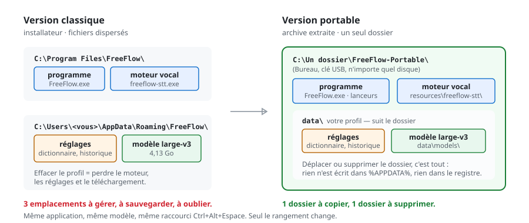

# FreeFlow Portable (Windows) — Téléchargement direct

  

[puce]:

**FreeFlow, mais sans installation.** Un dossier = l'application + vos réglages +
le modèle vocal. On le copie, on le déplace, on le supprime. Rien n'est installé,
rien n'est écrit dans `%APPDATA%`, et l'administrateur n'est jamais demandé.

## 3 étapes

| | |
|---|---|
| **1. Télécharger** | [**⬇ FreeFlow-Portable-1.2.0-win-x64.7z**](https://github.com/NtechSviet/freeflow-portable/releases/latest/download/FreeFlow-Portable-1.2.0-win-x64.7z) — 904 Mio (ou la [page de la Release](https://github.com/NtechSviet/freeflow-portable/releases/latest) pour les détails, le SHA-256 et les notes de version) |
| **2. Extraire** | Avec [7-Zip](https://www.7-zip.org) : clic droit sur le `.7z` → *7-Zip* → *Extraire vers « FreeFlow-Portable\ »*. Pas dans `C:\Program Files`. |
| **3. Lancer** | Double-clic sur `Lancer FreeFlow.cmd` dans le dossier extrait. |

Ensuite : `Ctrl+Alt+Espace` dicte, `Ctrl+Alt+H` ouvre le panneau. Au premier
démarrage, le modèle `large-v3` est téléchargé dans `data\models` (~3 Go avec une
carte NVIDIA, ~0,5 Go en CPU) ; après, tout fonctionne hors ligne.

## Version portable ou version officielle ?

| | FreeFlow officiel | FreeFlow Portable (ce dépôt) |
|---|---|---|
| Installation | installateur `.exe` | **aucune**, on extrait une archive |
| Réglages et dictionnaire | `%APPDATA%\FreeFlow` | **dans le dossier**, `data\` |
| Modèle vocal | `%APPDATA%\…\models` | **dans le dossier**, `data\models\` |
| Autre PC / clé USB | à réinstaller | **copier le dossier** |
| Désinstaller | panneau *Applications* | **supprimer le dossier** |
| Version Mac | oui | non (Windows x64) |

La dictée est identique (même application, même modèle). Seul le rangement
change. Détails et dépannage : **[INSTALLER.md](INSTALLER.md)** et
**[docs/DEPANNAGE.md](docs/DEPANNAGE.md)**.

Si quelque chose coince, [ouvrez une issue](https://github.com/NtechSviet/freeflow-portable/issues)
en joignant `journal-demarrage.txt` (créé par `Diagnostic.cmd`) et
`data\logs\freeflow.log`.

## Licence et crédits

- **FreeFlow** : © Alan — <https://github.com/AlanECE/freeflow>, licence MIT. Ce
  dépôt propose un packaging non officiel, sans lien avec l'auteur. Archive
  officielle (Windows et Mac) : [les Releases d'Alan](https://github.com/AlanECE/freeflow/releases/latest).
- **Cet emballage portable** (scripts, notices, correctif) : MIT, voir [LICENSE](LICENSE).
