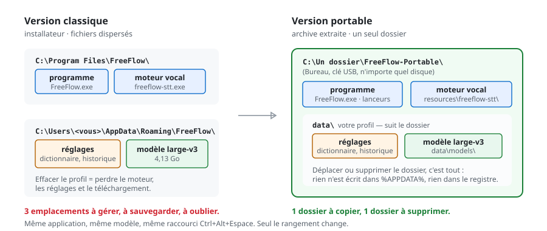

# FreeFlow Portable (Windows)

**FreeFlow, mais en version portable : un seul dossier, zéro installation.**

Le programme, votre profil (réglages, dictionnaire, historique, réunions) et le
modèle vocal vivent dans le même dossier, qui se déplace, se copie sur une clé
USB et se supprime sans laisser de trace. Rien dans `%APPDATA%`, rien dans le
registre, aucun droit administrateur.

<p align="center">
  <a href="https://github.com/NtechSviet/freeflow-portable/releases/latest">
    
  </a>
</p>

<p align="center">
  
  
  
  
</p>

---

## Ce n'est pas quoi, et c'est quoi

| | <nobr>FreeFlow officiel</nobr> | <nobr>FreeFlow Portable (ce dépôt)</nobr> |
|---|---|---|
| Installation | installateur `.exe` | **aucune** : on extrait une archive et on lance |
| Où vont les réglages | `%APPDATA%\FreeFlow` | **dans le dossier**, `data\` |
| Où va le modèle vocal | `%APPDATA%\…\models` | **dans le dossier**, `data\models\` |
| Déplacer vers un autre PC / une clé USB | non | **oui : copier le dossier** |
| Désinstaller | panneau *Applications* | **supprimer le dossier** |
| Accès administrateur | à l'installation | **jamais** |
| Version Mac | oui | non (Windows x64 uniquement) |

La dictée est exactement la même : `Ctrl+Alt+Espace`, `large-v3` en local, rien qui
quitte l'ordinateur. Seule la façon de ranger les fichiers change.

---

## Installer (3 étapes)

> ### 1. Télécharger
> Cliquez sur **[⬇ Télécharger](https://github.com/NtechSviet/freeflow-portable/releases/latest)**
> puis, dans la section *Assets*, sur `FreeFlow-Portable-1.2.0-win-x64.7z` **(904 Mio)**.
> C'est le seul fichier nécessaire — les liens « Source code » ne sont pas l'application.
>
> ### 2. Extraire
> Avec [7-Zip](https://www.7-zip.org) : **clic droit sur le `.7z` → 7-Zip →
> Extraire vers « FreeFlow-Portable\ »**. Un dossier simple, par exemple
> `C:\Users\<vous>\Desktop\FreeFlow-Portable` — **pas** `C:\Program Files`.
>
> ### 3. Lancer
> Double-clic sur **`Lancer FreeFlow.cmd`** dans le dossier extrait.
> Pour une icône dans le dossier : une fois `Creer le raccourci.cmd`.

Détails (place disque, SmartScreen, dossier créé par la première exécution,
gestion du modèle, désinstallation) : **[INSTALLER.md](INSTALLER.md)**.

Au premier démarrage, FreeFlow télécharge le modèle `large-v3` (~3 Go avec une
carte NVIDIA, ~0,5 Go en CPU) **dans `data\models`** ; ensuite tout fonctionne
hors ligne.



---

## Utilisation

| Raccourci | Effet |
|---|---|
| `Ctrl + Alt + Espace` | dicter — appuyer, parler, ré-appuyer |
| `Ctrl + Alt + H` | panneau : réglages, dictionnaire, historique |

Une icône apparaît près de l'horloge. Le texte s'écrit à l'endroit où se trouve
le curseur, dans n'importe quelle application.

## Vérifier que le mode portable est bien actif

Après la première exécution, le dossier contient :

```
FreeFlow-Portable\
├─ FreeFlow.exe
├─ Lancer FreeFlow.cmd
├─ portable.txt          <-- marqueur du mode portable
└─ data\
   ├─ settings.json      <-- vous êtes ici (et non dans %APPDATA%)
   ├─ logs\freeflow.log
   └─ models\            <-- le modèle vocal
```

C'est la présence de `portable.txt` à côté de `FreeFlow.exe` qui redirige le
profil vers `data\`. Si `data\` n'apparaît pas, l'application n'a pas démarré :
voir le [dépannage](docs/DEPANNAGE.md).

## Si ça ne marche pas

| Symptôme | Solution |
|---|---|
| Le texte s'affiche mais ne s'écrit dans aucune application | double-clic sur `Reparer-Etiquettes.cmd`, puis quitter et relancer |
| Double-clic sans effet, fermeture immédiate | double-clic sur `Diagnostic.cmd` → il écrit `journal-demarrage.txt` |
| Windows demande un mot de passe administrateur | le dossier est dans `C:\Program Files` : le déplacer |
| Raccourci global inactif | une autre instance de FreeFlow tourne déjà (installation classique et portable sont deux applications distinctes) |

**Ne jamais lancer FreeFlow en tant qu'administrateur** : Windows empêche alors
l'application de taper dans les fenêtres normales. Tous les cas connus, avec
leurs causes, sont expliqués dans **[docs/DEPANNAGE.md](docs/DEPANNAGE.md)**
(étiquette d'intégrité « faible », `--no-sandbox`, UIPI…).

## Arrêter FreeFlow : aucun processus ne doit rester

Quitter par l'icône de la zone de notification (**clic droit → Quitter**).
Quelques secondes plus tard, il ne doit rester **ni** `FreeFlow.exe` **ni**
`freeflow-stt.exe` :

```powershell
Get-Process FreeFlow, freeflow-stt -ErrorAction SilentlyContinue
# aucun résultat attendu
```

Cette version le garantit, y compris quand aucune de nos lignes de code ne peut
s'exécuter (fenêtre tuée, console fermée, plantage) : un garde-fou détaché attend
la disparition du programme puis arrête ce qui reste du moteur. Un
`freeflow-stt.exe` oublié garde ~700 Mo de mémoire **et** le port `48123`, ce qui
gêne le démarrage suivant. S'il en reste un (ancienne version, arrêt brutal) :

```cmd
taskkill /IM FreeFlow.exe /T /F
taskkill /IM freeflow-stt.exe /F
```

---

## Ce que fabrique ce dépôt

Ce dépôt contient **l'archive prête à l'emploi** (en [Releases](https://github.com/NtechSviet/freeflow-portable/releases))
**et le kit** qui la fabrique à partir de l'installation officielle. Les binaires
ne sont pas versionnés : GitHub refuse les fichiers de plus de 100 Mo.

```powershell
git clone https://github.com/NtechSviet/freeflow-portable.git
cd freeflow-portable
powershell -ExecutionPolicy Bypass -File .\build-portable.ps1 -Destination "D:\FreeFlow-Portable"
```

Prérequis : Windows 10/11 x64, [Node.js](https://nodejs.org) 18+, FreeFlow 1.2.0
installé une fois (l'installateur officiel sert de source), ~7 Go libres.
Le script copie le runtime, extrait `resources\app.asar`, applique le correctif,
copie les lanceurs, remet l'étiquette d'intégrité à « moyen » et crée le raccourci.

### Le correctif, en clair

`resources\app\main.js` ne connaît pas le mode portable : Electron écrit dans
`%APPDATA%`. Le patch ajoute, juste après le `require('child_process')` :

```js
var __FF_PORTABLE__ = null;
try {
  var __ffExeDir = path.dirname(process.execPath);
  if (['portable.txt', 'data', 'FreeFlow Portable'].some(function (n) {
        return fs.existsSync(path.join(__ffExeDir, n));
      })) {
    __FF_PORTABLE__ = __ffExeDir;
    try { fs.mkdirSync(path.join(__ffExeDir, 'data'), { recursive: true }); } catch (e0) { }
    app.setPath('userData', path.join(__ffExeDir, 'data'));
  }
} catch (e1) { __FF_PORTABLE__ = null; }
```

et redirige la valeur par défaut de `modelCache` vers `<dossier>\data\models`.
`fs.mkdirSync` est indispensable : `app.setPath('userData', …)` lève une exception
si le dossier n'existe pas, et l'application reste bloquée sur une boîte de
dialogue sans écrire de journal.

### Le second correctif : aucun processus fantôme

`tools/patch-quit.js` corrige une fuite réelle de l'application d'origine sous
Windows. FreeFlow arrête bien son moteur lors d'une fermeture normale, mais si
Electron meurt autrement, le moteur (`freeflow-stt.exe`, ~700 Mo, port `48123`)
reste en vie ; la **fermeture propre ne peut pas lui être demandée** par ce
build, car Windows protège la variable qui détient le jeton contre toute lecture
par un autre processus. Le patch ajoute donc, dans cet ordre :

1. `lib/sidecar.js` → `stopAll()` : à la sortie, tuer l'arbre du moteur, ce qui
   écoute sur le bloc de ports et tout binaire du moteur vivant sous
   `<dossier>\resources\` ;
2. `main.js` → `quitApp()` appelle `stopAll()` au lieu de `stop()` ;
3. `lib/-kill-engine.ps1` : un garde-fou détaché qui attend la disparition du
   programme puis tue ce qui reste du moteur — y compris quand plus aucune de nos
   lignes de code ne s'exécute (fenêtre tuée, console fermée, plantage), avec une
   trace `[quit guard]` dans `data\logs\freeflow.log`.

### Pourquoi 904 Mio et pas 6,3 Go

| Élément | Taille | Dans l'archive ? |
|---|---|---|
| Application + runtime Electron + lanceurs | ~1,0 Go | oui |
| `resources\freeflow-stt\` (moteur faster-whisper/CUDA) | ~1,5 Go | oui |
| `data\models\` (large-v3) | 4,13 Go | **non** — téléchargé au 1er démarrage |
| Votre profil (`data\`) | — | **non**, jamais |

Un fichier joint à une Release est limité à 2 Go sur GitHub : le modèle ne peut
pas y tenir. Il est donc téléchargé par FreeFlow lui-même au premier lancement —
exactement comme le fait l'installateur officiel de l'auteur.

---

## Versions testées

| Élément | Version |
|---|---|
| FreeFlow | 1.2.0 |
| Electron | 44.9.0 (Chromium 44, Node 24.22.0) |
| Modèle | `large-v3` (faster-whisper / CTranslate2, CUDA + CPU) |
| `@electron/asar` | 3.2.10 |

Une version ultérieure de FreeFlow peut déplacer l'ancre du patch :
`tools/patch-main.js` échoue alors avec un code explicite plutôt que d'écrire un
fichier douteux. Le correctif produit ici a été vérifié **octet pour octet**
(`main.js` : 93 611 octets, SHA-256 `54c8e9d2…318edd`).

## Licence et crédits

- **FreeFlow** : © Alan — <https://github.com/AlanECE/freeflow> (licence MIT).
  Ce dépôt n'est pas affilié à l'auteur. L'archive d'une Release redistribue
  l'application et son moteur ; `LICENSE`, `LICENSES.chromium.html` et
  `THIRD_PARTY_NOTICES.md` d'origine y sont conservés. Si elle vous est utile,
  allez mettre une étoile au projet d'origine.
- **Scripts, notices et correctif de ce dépôt** : MIT, voir [LICENSE](LICENSE).

## Sommaire des fichiers

| Fichier | Rôle |
|---|---|
| [INSTALLER.md](INSTALLER.md) | mode d'emploi complet de la version portable |
| [docs/DEPANNAGE.md](docs/DEPANNAGE.md) | les pannes réelles rencontrées, cause et réparation |
| `build-portable.ps1` | fabrique le dossier portable depuis l'installation officielle |
| `tools/patch-main.js` | applique le correctif portable à `main.js` (idempotent, codes d'erreur explicites) |
| `tools/patch-quit.js` | arrêt complet : `stopAll()`, `quitApp()` et garde-fou de sortie |
| `portable\` | lanceurs, notice, `portable.txt` et `lib\-kill-engine.ps1` copiés dans le dossier produit |
